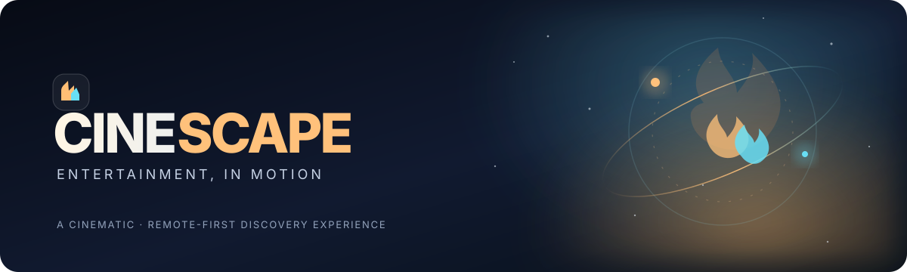
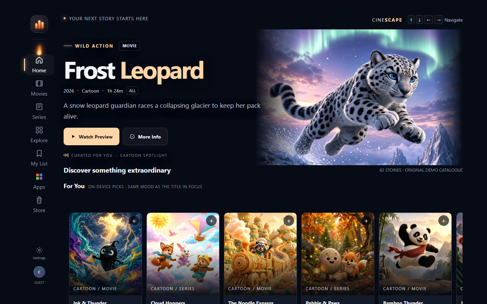
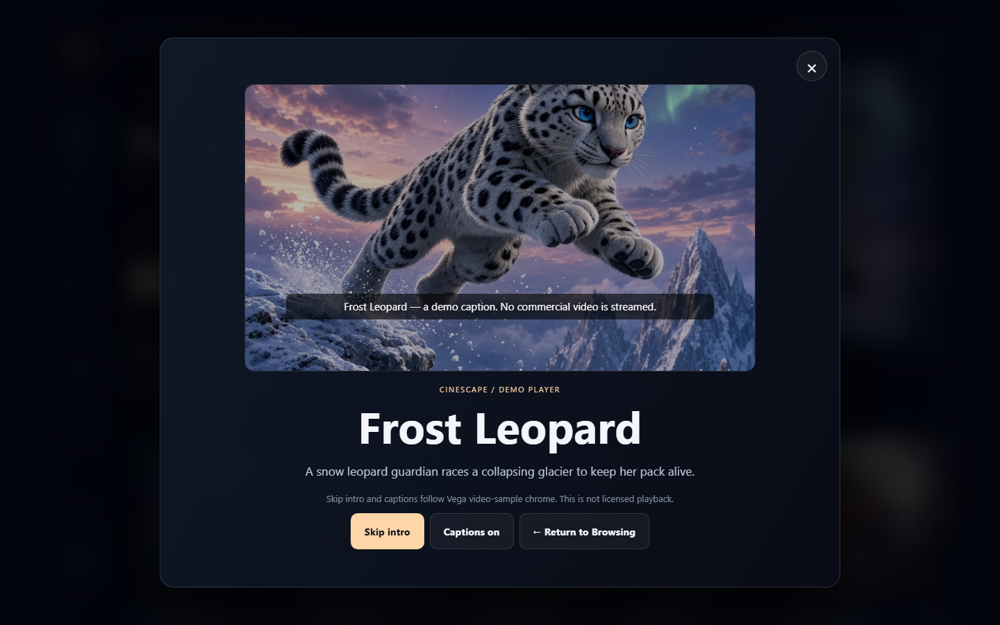
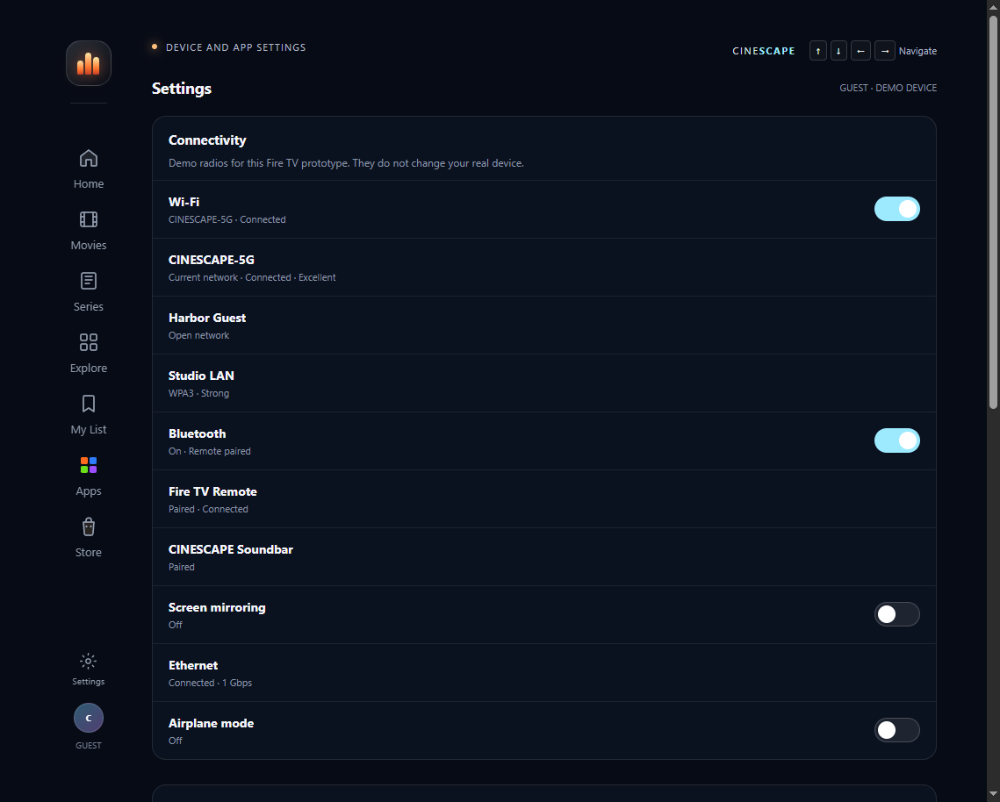

<!-- CINESCAPE project README -->
<p align="center">
  
</p>

<p align="center">
  <strong>A cinematic, remote-first entertainment discovery experience.</strong>
  <br>
  Explore fictional movies and series through genre-led shelves, atmosphere-driven visuals, and expressive focus transitions.
</p>

<p align="center">
  
  
  
  
</p>

<p align="center">
  <a href="#-experience">Experience</a> ·
  <a href="#-get-started">Get started</a> ·
  <a href="#-remote-controls">Controls</a> ·
  <a href="#-architecture">Architecture</a> ·
  <a href="#-platform-status">Platform status</a>
</p>

<p align="center">
  
  <br>
  <sub>Home — cartoon hero, For You row, D-pad focus</sub>
</p>
<p align="center">
  
  &nbsp;&nbsp;
  
  <br>
  <sub>Preview chrome · Guest Settings</sub>
</p>

---

## ✨ Experience

**CINESCAPE** is a prototype for discovering entertainment on a television. The interface is built around a simple idea: browsing should feel cinematic, while navigation should remain fast and predictable.

| Feature | What it does |
| --- | --- |
| **Cinematic home** | Highlights a featured title and organizes content into browsable shelves. |
| **Genre-aware atmosphere** | Adapts ambient colors and motion to the currently focused show's visual theme. |
| **Fire → Water → Fire focus effect** | A brief water ripple extinguishes the previous focus flame; the newly focused card receives a restrained ignition glow. |
| **Remote-first navigation** | Supports directional navigation, Select/Enter, and Back/Escape behavior in the browser prototype. |
| **Entertainment discovery** | Original (non-licensed) catalogue across movies, series, cartoons, studies, family, and more. |
| **For You** | On-device picks from the title in focus — Fire TV “AI-enhanced viewing” without a cloud model. |
| **Guest Settings** | Connectivity demo plus theme, flame colour, language (EN/HI), captions, restore/reset. |
| **Demo player chrome** | Skip intro and captions, matching Vega video-sample patterns. No commercial stream. |
| **Details and discovery tools** | Opens title details and includes search, category browsing, and a local My List. |
| **Reduced motion** | Provides a simple reduced-motion toggle in the prototype and respects the browser's reduced-motion preference. |

### The signature interaction

1. Move focus with the remote or arrow keys.
2. The previous card shows a small water extinguish effect.
3. The newly focused card receives a short ignition effect.
4. The surrounding atmosphere shifts to match the new title's genre theme.

The effect is decorative: focus state changes immediately, so animation should never be required to understand or use the interface.

## 🚀 Get started

### Requirements

- **Node.js 18 or newer**
- A modern browser

The local server uses Node.js built-ins only. There are no third-party npm packages to install.

### Run locally

```bash
npm start
```

Then open **[http://localhost:4173](http://localhost:4173)**.

To start the server directly:

```bash
node server.js
```

To use a different port, set the `PORT` environment variable before launching the server. For example, in PowerShell:

```powershell
$env:PORT=4300
node server.js
```

Then open `http://localhost:4300`.

## 🎮 Remote controls

| Remote / keyboard | Action |
| --- | --- |
| **↑ ↓ ← →** | Navigate between visible controls and content cards |
| **Enter / Select** | Open a title or activate the focused action |
| **Escape / Backspace** | Close a dialog or return to Home |
| **M** | Toggle reduced motion in the browser prototype |

The TV interaction model prioritizes clear focus indication, large cards, generous spacing, and predictable movement. Test with a keyboard during development; target-device remote behavior still needs to be verified as described below.

## 🧭 Architecture

CINESCAPE deliberately keeps the initial prototype small and easy to run.

- **UI and interaction layer — `index.html`**  
  Contains the interface, responsive styling, sample catalogue, background themes, focus effects, modal views, search, categories, and My List behavior.
- **Local static server — `server.js`**  
  Serves project files using Node.js built-in modules.
- **Project commands — `package.json`**  
  Defines the `npm start` command and Node.js engine requirement.
- **Documentation — `docs/`**  
  Tracks the implementation plan, demo flow, testing notes, and platform-porting considerations.
- **README artwork — `assets/cinescape-banner.svg`**  
  Original project banner used at the top of this page.

### Repository layout

```text
.
├── assets/
│   ├── cinescape-banner.svg
│   └── posters/
├── docs/
│   ├── DEMO_SCRIPT.md
│   ├── FIRE_TV_PORTING.md
│   ├── FRICTION_LOG.md
│   ├── IMPLEMENTATION_PLAN.md
│   ├── SUBMISSION.md
│   └── TESTING.md
├── .gitignore
├── index.html
├── LICENSE
├── package.json
├── README.md
└── server.js
```

### Hackathon resources

Built against Amazon AppDev 2026 Resources (Fire TV path). Official starters we mapped to: drawer nav + grid + hero (`react-native-multi-tv-app-sample`), focus / i18n / scrolling (`vega-tv-interfaces-sample`), player chrome (`vega-video-sample`).

Paste-ready Devpost text, product feedback, and feature requests: [`docs/SUBMISSION.md`](docs/SUBMISSION.md). Judging bonus log: [`docs/FRICTION_LOG.md`](docs/FRICTION_LOG.md). License: [MIT](LICENSE).

This machine still cannot produce a Fire OS APK or Vega VPKG (no Android / Vega SDK). The required demo video must be recorded on a Fire TV device or official simulator — see [`docs/FIRE_TV_PORTING.md`](docs/FIRE_TV_PORTING.md).

## 🔐 Data and content

- The included catalogue uses fictional titles and sample descriptions.
- My List uses browser-local storage when it is available.
- The prototype does not require an account, database, backend, or external content API.
- The preview/details experience is illustrative; it does **not** stream commercial movies or series.
- Use only appropriately licensed content and artwork when integrating real entertainment catalogues.

## 📺 Platform status

> [!IMPORTANT]
> **CINESCAPE is currently a browser-runnable prototype, not a signed or installable Fire TV/Vega OS package.** The UI and keyboard-driven interactions are useful for development, but they do not establish compatibility with a physical Fire TV or an official platform simulator.

Before describing the app as device-ready, the next platform steps are:

1. Confirm the hackathon's target runtime and current official SDK requirements.
2. Package the UI using the supported Fire OS or Vega OS application structure.
3. Map native remote and Back events to the browsing/navigation model.
4. Verify layout, focus behavior, animation performance, and lifecycle on an official simulator or physical device.
5. Record actual SDK versions and test results in [`docs/TESTING.md`](docs/TESTING.md).

See [Fire TV / Vega porting notes](docs/FIRE_TV_PORTING.md) for the planned validation path.

## 🗺️ Roadmap

- [x] Establish a cinematic entertainment-browsing concept
- [x] Add sample titles, details, category discovery, search, and My List
- [x] Implement show-theme atmosphere and fire/water focus effects
- [x] Document the target-platform validation path
- [ ] Build and package with the selected official Fire TV/Vega toolchain
- [ ] Verify remote navigation and performance on the target simulator/device
- [ ] Capture a truthful end-to-end demo of the tested build

## 🤝 Contributing

Ideas, focused bug reports, and improvements are welcome. For issues involving a particular device or simulator, include the platform/runtime version, steps to reproduce, expected behavior, and actual behavior.

---

<p align="center">
  <sub>Built as an original entertainment-discovery concept · CINESCAPE</sub>
</p>
