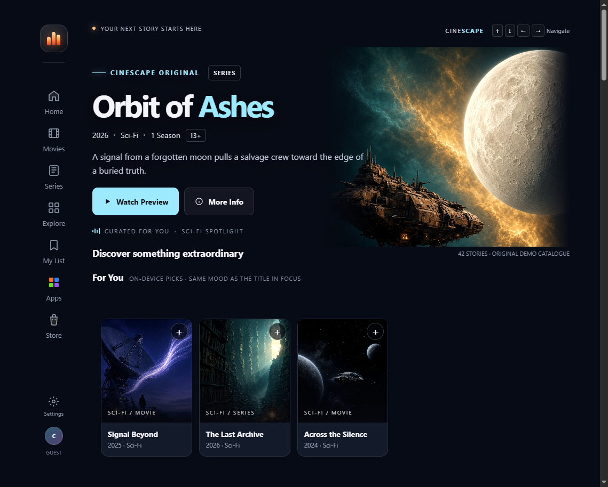

# CINESCAPE

Remote-first entertainment discovery for a 10-foot screen. Original (non-licensed) catalogue, D-pad spatial navigation, and a living-room UI you can run in a browser.

```bash
npm install
npm start
# http://localhost:4173
```

Arrow keys move focus. Enter opens a title. Escape goes back. This is a **Fire TV web prototype**, not a signed Fire OS APK or Vega package, and it does **not** stream commercial movies.

<p align="center">
  
</p>

---

## What you get

| Surface | Behavior |
| --- | --- |
| Home | Hero + shelves (For You, genre, family, cartoons, studies) |
| Search / My List | In-catalogue filter; list persisted in `localStorage` |
| Apps / Store | Launcher rows after My List (placeholders, not storefront billing) |
| Guest Settings | Connectivity vs appearance, flame colour, EN/HI, captions |
| Preview | Skip intro + captions chrome. No licensed stream |
| Focus | One active card. Flame on native focus / latest selection; smoke on the previous tile |

**For You** seeds from the title in focus (same genre/theme). If AWS credentials are present, `POST /api/foryou` asks Amazon Bedrock (`amazon.nova-lite-v1:0`) for six catalogue ids. If keys are missing or the model call fails, the same row stays **on-device**. The UI does not 500.

## Quick start

Needs **Node.js 18+**.

```bash
git clone https://github.com/surajns0033-collab/cinescape-fire-tv.git
cd cinescape-fire-tv
npm install
npm start
```

Open [http://localhost:4173](http://localhost:4173). On a Fire TV Silk browser or Android TV emulator on the same LAN, use the machine’s LAN IP and port `4173` (the server binds `0.0.0.0`).

| Input | Action |
| --- | --- |
| ↑ ↓ ← → | Move between rail and cards |
| Enter / Select | Activate |
| Escape / Backspace | Close or return Home |
| M | Toggle reduced motion |

Optional Bedrock (not required to demo):

```bash
cp .env.example .env
# set AWS_REGION, AWS_ACCESS_KEY_ID, AWS_SECRET_ACCESS_KEY
# enable amazon.nova-lite-v1:0 in that region
```

Never commit `.env`. `GET /api/status` reports whether credentials are loaded.

## Architecture

One HTML document plus a small Node server. No React Native, no Vega SDK, no database.

```text
index.html      # UI, catalogue, spatial focus, settings, preview chrome
server.js       # static files, GET /api/status, POST /api/foryou
package.json    # npm start, optional @aws-sdk/client-bedrock-runtime
.env.example    # AWS env names only
assets/         # banner, original posters, screenshots
docs/           # porting, testing, submission notes
LICENSE         # MIT
```

`server.js` serves MIME-typed files from the repo root. Unknown paths 404. Path traversal is rejected. For You accepts a JSON `{ seed, catalog }`, returns `{ source: "bedrock"|"on-device", ids: [...] }`, and only keeps ids that exist in the posted catalogue.

## What this is not

- Not an installable Fire OS / Vega binary (no Android or Vega SDK in this tree).
- Not a claim that the demo was recorded on a physical Stick unless you recapture it.
- Not licensed IP. Catalogue titles and posters are original fiction.
- Not a paid VideoMule / cloud CMS. Ranking is optional Bedrock or local mood match.

Packaging path: [`docs/FIRE_TV_PORTING.md`](docs/FIRE_TV_PORTING.md). Device checklist: [`docs/TESTING.md`](docs/TESTING.md).

## License

[MIT](LICENSE). Public repo: [surajns0033-collab/cinescape-fire-tv](https://github.com/surajns0033-collab/cinescape-fire-tv).
